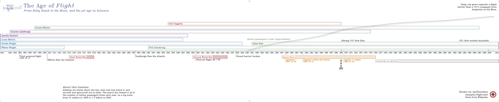
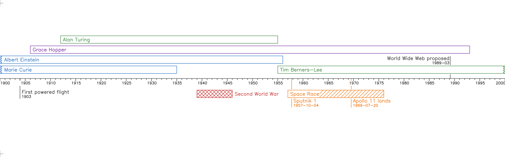
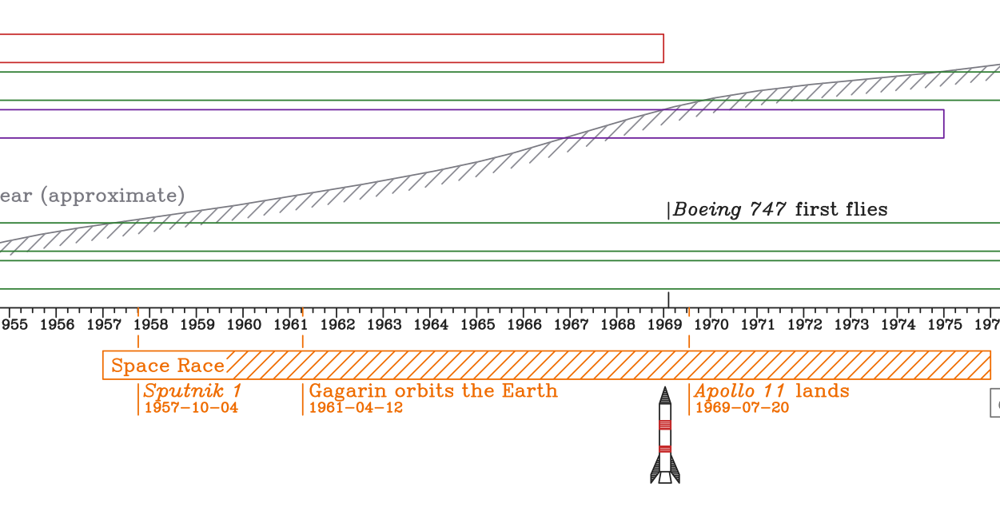
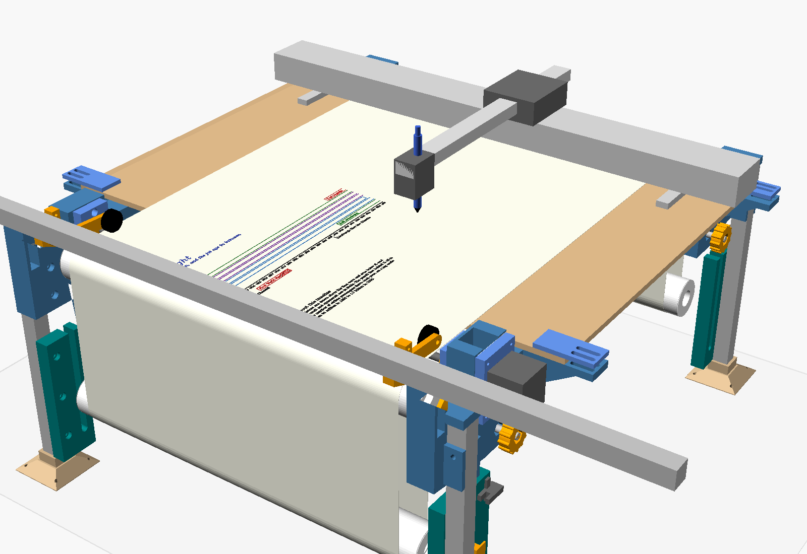
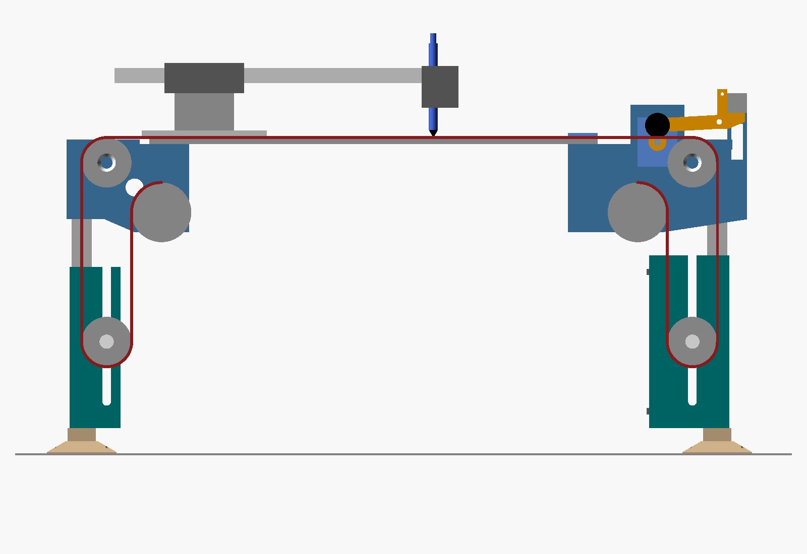
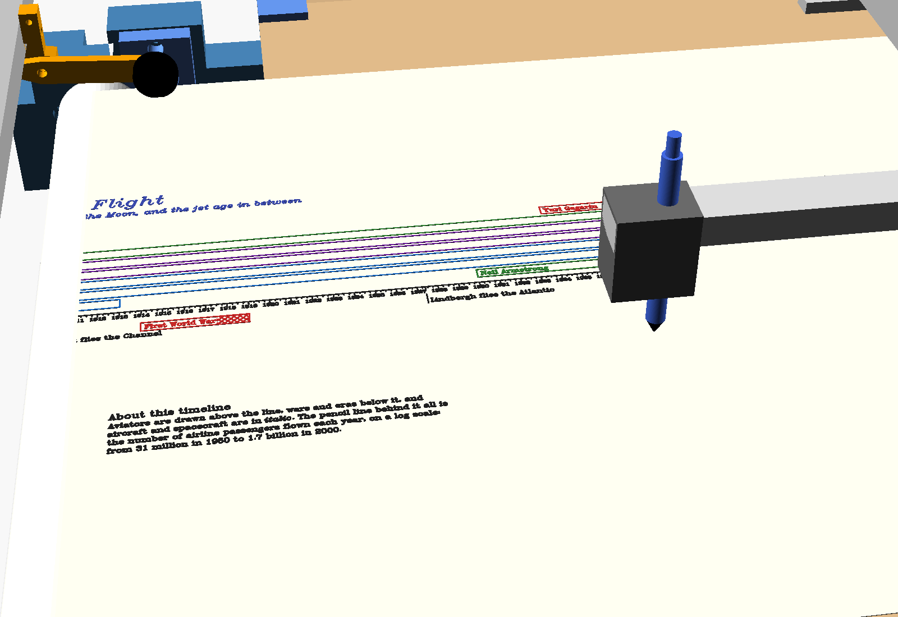

# AxiTimeline

Timelines drawn by a pen plotter on long rolls of paper. You describe people, events and periods in a plain-text
language, `.axitl`, and AxiTimeline lays them out, draws every line and letter as pen strokes, and plots them on
an [AxiDraw SE/A3](https://axidraw.com/) one pen at a time, moving the roll through in strips.

> **You don't need a plotter.** The software runs on its own and writes ordinary SVG files, true to size in
> millimetres, so if all you want is a rendered timeline to look at, print or send elsewhere, `uv sync` and
> `axitime render` are all it takes. The AxiDraw, its Python API and the paper transport only come into it
> when you plot.



*[`examples/flight.axitl`](examples/flight.axitl), a metre long, as `axitime render` previews it with each pen in
its own colour.*

This repository has:

- **libaxitl**, the engine: it parses `.axitl`, lays the timeline out and renders it as SVG. It's a pure library
  with no file, network or clock access of its own, so other programs (a web front-end, say) can reuse it.
- **axitime**, the command-line program that hosts libaxitl, writes the SVG files and drives the plotter.
- An editor extension for **VS Code**, with highlighting, completion, hover help, errors as you type and a
  rendered preview.
- **The paper transport**, a printed stand that carries the roll under the AxiDraw, modelled in OpenSCAD.

**Status, November 2026.** Parsing, layout, rendering and the `check`, `list-pens` and `render` commands work.
`plot` has drawn its first test strips on a real AxiDraw. The paper transport is designed but not yet built, so
for now `plot` asks you to move the paper on by hand between strips.

## What it looks like

This source, [`examples/century.axitl`](examples/century.axitl):

```text
timeline start=1900 end=1999 length=40cm width=120 baseline=middle

^!!person "Marie Curie" 1867-1934 blue
^!person "Albert Einstein" 1879-1955 blue
^person "Grace Hopper" 1906-1992 violet
^person "Alan Turing" 1912-1954 green
^person "Tim Berners-Lee" 1955- green

v!span "Second World War" 1939-1945 red fill=crosshatch

!group "Space Race" 1957-1975 orange fill=diagonal time_label=day {
  event "Sputnik 1" 1957-10-04
  event "Apollo 11 lands" 1969-07-20
}

event "First powered flight" 1903-12-17 time_label=year
event "World Wide Web proposed" 1989-03 time_label=month
```

is drawn like this:



Some things to notice:
- Lives that began before 1900 get a torn edge where the timeline starts, as does one still going at its end.
- `^` and `v` put an entry above or below the baseline. Without one, AxiTimeline chooses the side with room.
- `!` and `-` raise or lower an entry's priority, which decides who gets the lanes nearest the baseline.
- Events stand on poles. A pole is broken wherever it would cross other ink, and `time_label=` writes the date
  under the event's name.
- Every letter is drawn as strokes from a single-line Hershey font, which a pen can draw.

## Dressing it up

The flight timeline at the top uses most of the rest of the language. Close up, from 1955 to 1975:



- **A title and credits** sit in the top-left and bottom-right corners, each with an optional drawing beside it,
  and everything else keeps clear of them:

  ```text
  title "The Age of *Flight*" indigo
      subtitle="From Kitty Hawk to the Moon, and the jet age in between"
      font=HersheySerifBold font_size=11mm
      illustration(illustrations/biplane.svg at=left)
  ```

- **Notes** are paragraphs of free text on the top or bottom edge, anchored to the start, the end or a date.
  Quoted lines one after another make one paragraph, wrapped to the note's width:

  ```text
  note anchor=1920 edge=bottom width=150mm {
      heading "About this timeline"
      "**Aviators** are drawn above the line, wars and eras below it, and aircraft and spacecraft"
      "are in *italic*. ..."
  }
  ```

- **Bold, italic and ~~strikethrough~~**, written as in Markdown, in labels, the title, credits and notes. They're
  drawn in the font's real bold and italic cuts, never faked.
- **Illustrations** can be coloured. A pen can't fill a shape, so `fill=solid` hatches each filled shape, and
  `pens=auto` draws each of the drawing's colours in the nearest pen, as a pass of its own. The rocket is red and
  black:

  ```text
  event "*Apollo 11* lands" 1969-07-20 illustration(illustrations/rocket.svg height=24mm fill=solid pens=auto)
  ```

- **Graphs** draw a line of values behind the timeline, in pencil, without moving anything. The points come from
  a CSV file or are written inline; the scale can be linear or log, the line straight, smooth or stepped, and
  shaded underneath:

  ```text
  graph "Airline passengers a year (approximate)" HB-pencil
      y_scale=log origin=30 line=smooth height=70mm
      fill=diagonal fill_pen=2H-pencil fill_depth=3mm {
      1950    31
      1960   106
      ...
  }
  ```

## The hardware

The AxiDraw draws a strip of the roll at a time, 25cm by default, then the paper moves on and it draws the next.
The paper transport is a printed stand that does the moving: the AxiDraw sits on a board on four legs, and the
roll runs under its bar, from a supply roll at the back to a take-up roll at the front.





In the cutaway the paper (red) runs from left to right:

1. It comes off the **supply roll** and hangs in a loop round a weighted roller, the **dancer**, before rising
   over the back roller onto the board.
2. It crosses the board under the AxiDraw's bar and pen.
3. A gritted **drive roller**, set flush with the board just beyond the pen's reach, moves it on. Sprung pinch
   wheels press each margin onto it, as on a vinyl cutter. This is the only movement that has to be exact.
4. It turns down over the front roller, round the front dancer and up onto the **take-up roll**.

The dancers keep the paper at the same tension whichever way it moves, and each roll's motor only has to keep its
dancer between two sensors. The paper goes back to the start after every pen, so it moves both ways.



The design is written up in [`docs/transport.md`](docs/transport.md), and
[`hardware/transport`](hardware/transport) has the OpenSCAD models, what to print, the parts to buy and the order
of assembly. These views come from its `render_views.sh`; the AxiDraw in them is reduced to simple blocks.

## Getting started

You need [uv](https://docs.astral.sh/uv/), which also fetches Python 3.12 if you don't have it. Nothing here needs
the plotter until you come to `plot`. From the repo:

```bash
uv sync
```

```bash
uv run axitime check examples/century.axitl
```

```bash
uv run axitime render examples/century.axitl -o renders
```

`render` writes `renders/century-preview.svg` with every pen, and one `century-<pen>.svg` per pen for plotting.
They're at true size in millimetres, so they open in Inkscape with each pen as a layer:

```bash
open -a Inkscape renders/century-preview.svg
```

Only on the computer that drives the AxiDraw, install its Python API as well (it comes from Evil Mad Scientist, not
PyPI):

```bash
uv sync --extra axidraw
```

## Commands

| Command | What it does |
|---|---|
| `axitime check FILE` | Parses and lays out the timeline and reports errors and warnings: bad dates, a full lane, a label that can't fit, a page wider than the plotter reaches. `--json` for scripts. |
| `axitime list-pens FILE` | The pens the job needs, the baseline's pen first, with how much each one draws. |
| `axitime render FILE -o DIR` | Writes the preview and one SVG per pen. A slice of the roll with `--start-offset`/`--length` (e.g. `137cm`) or `--from`/`--to` (dates); `--bleed` (default 2mm) runs ink past a cut edge. |
| `axitime plot FILE-PEN.svg` | Plots one pen's SVG. `--simulate` shows the strips without moving anything; `--dry-run` goes through every motion with the pen up; `--start-offset` resumes partway along the roll. |
| `axitime convert-font FONT` | Turns a TrueType, OpenType or Type 1 font (`.ttf`, `.otf`, `.ttc`, `.pfa`, `.pfb`) into an SVG font a timeline can name with `font="…svg"`. Letters are drawn as their outlines, so they come out hollow unless a title fills them with `font_fill=`: best for large text such as a title. `--characters` keeps just the ones you need; `--index` picks a font from a `.ttc` collection. |

A timeline that ends at `now` takes the clock's date; `--now DATE` pins it, so a job can be re-rendered later
exactly as it was.

## Plotting a job

A job is plotted one pen at a time, from the per-pen SVGs `render` wrote. The first pass is the pen that draws the
baseline and its ruler-like ticks (`black`). Those are the reference every later pass, and any resumed run, lines
up against.

- **Before moving**, `plot` shows the pen, the stretch of roll, the ink and the strips, then asks you to type the
  pen's name. Answering y/n would be too easy to wave through on autopilot.
- **The roll goes through in strips**, running under the AxiDraw's base beam, 25cm at a time by default. Between
  strips you move the paper on by an exact distance, until the motorised transport exists. Strips with nothing
  for the current pen are skipped.
- **Ctrl+C, the AxiDraw's pause button, or any error** lifts the pen, sends the carriage home and switches the
  motors off. The job log then says where it stopped, so you know what `--start-offset` to resume from.
  Measure from a labelled tick, or from the pencil crop marks every 50cm.
- **A job log** beside the SVGs records every run. Each SVG carries a job hash, a fingerprint of the source, the
  software versions, `now` and every illustration, font and data file used. `plot` refuses a file from a different version
  of a timeline it has already started plotting, so passes drawn from different layouts can't end up on the same
  paper (`--force` overrides this, and the log records it).

The plotter's travel, strip length and pen settings can be adjusted in `~/.config/axitime/plotter.toml`; see
[`axitime/config.py`](axitime/src/axitime/config.py).

## The language in brief

```text
[side][priority]keyword "Label" dates [pen] [key=value ...] [illustration(file.svg)]
```

- **Entries:** `person`, `span` and `group` sit in lanes: a person as a line from their name to their death, with
  a stroke across each end, and spans and groups as bars. An `event` is a single moment on a pole. A group's
  members, in `{ }`, take its side, pen and settings unless they say otherwise.
- **Dates:**
  - Write a date at any precision, from `1963` to `1963-11-22T12:30:00`.
  - Years before AD 1 take `BC`: `44BC-03-15`.
  - Ranges are `1642-1727` between years, and `1962-10-16/1962-10-28` when either end is finer than a year.
  - `1953-` is ongoing.
- **Pens** are named after what goes in the plotter: `red`, `blue` and so on, `HB-pencil` and other grades, and
  `fountain-blue`.
- **Settings:**
  - `fill=` shades the bars of spans and groups: `diagonal`, `crosshatch`, `wave`, `dots` or `solid`. `fill_pen=`
    draws the fill in a pen of its own: a soft pencil under a black outline, say.
  - `font=` takes a built-in Hershey font, or your own SVG stroke font, and `font_size=` sets the size.
  - `time_label=` writes an event's date under its name.
- **Title and credits:** `title "Text" subtitle="…"` goes in the top-left corner, and `credits { heading "…" "…" }`
  in the bottom-right, each with an optional `illustration(file.svg)` beside it, on the corner's side. A logo
  beside the credits is scaled to their height, and `max_height=` limits both. The credits' lines are aligned to the
  right, against the logo; `at=` and `align=` change either. Nothing else is placed on them. A title in a converted
  outline font can fill its letters with `font_fill=solid` (or any other fill pattern).
- **Notes:** `note anchor=start { heading "…" "…" }` puts paragraphs of text on the top or bottom edge (`edge=`),
  at the start, middle or end, or centred on a date. Lines are aligned left, or right with `align=right`, and a
  note can have an illustration beside it.
- **Formatting:** `*italic*`, `**bold**` and `~~strikethrough~~` in labels, the title, credits and notes, drawn in
  the font family's own bold and italic cuts.
- **Graphs:** `graph "Title" data="file.csv"` draws a line of values under everything else, in pencil by default,
  with its origin on the baseline. It never moves anything; it's broken where it would run through text.
  - Points come from a CSV file read as it comes (pick the rows, columns and date format), or are written inline.
  - Linear or log scale, straight, smooth or stepped lines, and shading under the line or as a drop shadow,
    in its own `fill_pen=` if you like. Value scales along the roll carry the `unit=`.
- **Files:**
  - `include "file.axitl"` pulls in shared entries, optionally shifting their priority or side.
  - `illustration(file.svg)` attaches a drawing to an entry. Inside the parentheses, `fill=solid` hatches its
    filled shapes and `pens=auto` draws each of its colours in the nearest pen, each plotted in its own pass.
  - `//` starts a comment.
- **Lengths** are millimetres unless they say `cm` or `m`.

The full rules are in [`docs/language-spec.md`](docs/language-spec.md). The other examples show more:
[`title-and-credits.axitl`](examples/title-and-credits.axitl), [`notes.axitl`](examples/notes.axitl) and
[`formatting.axitl`](examples/formatting.axitl) each show one of the features above on its own,
[`industrial.axitl`](examples/industrial.axitl) uses includes, groups and an illustration,
[`chernobyl.axitl`](examples/chernobyl.axitl) is a timeline to the second, [`labels.axitl`](examples/labels.axitl)
shows where labels go when they're longer than their bars, [`people.axitl`](examples/people.axitl) shows how people
are drawn, ended and labelled, and [`crash-1929.axitl`](examples/crash-1929.axitl) and
[`reactor-power.axitl`](examples/reactor-power.axitl) draw graphs under their timelines.

## Editor support

[`editors/vscode`](editors/vscode) adds `.axitl` support to VS Code:
- highlighting, in which typos stay uncoloured;
- completion that knows what fits where;
- hover help taken from the language spec;
- the errors and warnings from `axitime check`, shown when you open or save a file;
- a preview panel showing the rendered timeline.

Its [README](editors/vscode/README.md) explains how to install it.

## How it fits together

```text
.axitl ──parse──> AST ──layout──> ResolvedLayout ──draw──> strokes ──render──> SVG, one per pen ──plot──> paper
  │                       ▲
  └── includes, fonts,    └── now (the clock, or --now)
      illustrations, data
```

- `parse` is the only stage that reads anything beyond the text it's given, through a function its host supplies.
  That function gives libaxitl its includes, illustrations, custom fonts and graph data.
- `layout` and `render` are pure: the same input always gives byte-identical output.
- `plot` never reads `.axitl`, only a frozen per-pen SVG. So every pass of a job draws from exactly the same
  layout.

The design is written up in [`docs/interpreter-cli-spec.md`](docs/interpreter-cli-spec.md), and
[`docs/known-gaps.md`](docs/known-gaps.md) lists what's still undecided.

## Repository layout

| Path | Contents |
|---|---|
| `libaxitl/` | The engine: parsing, dates, layout, text shaping, drawing and SVG rendering, with the bundled fonts |
| `axitime/` | The command line, the job hash and log, and the plotter and paper-transport drivers |
| `editors/vscode/` | The VS Code extension |
| `hardware/transport/` | The paper transport's printed parts in OpenSCAD, with what to print, buy and assemble |
| `examples/` | Example timelines |
| `docs/` | The language and interpreter specs (the canonical copies), the transport's design and the list of known gaps |
| `vendor/` | One wheel from the AxiDraw API, kept here so installs work on any machine ([why](vendor/README.md)) |

## Development

```bash
uv run pytest
```

The tests cover parsing, layout, rendering, the job hash, plotting against a simulated AxiDraw, and the editor
extension's vocabulary. The extension's own tests run under node:

```bash
node editors/vscode/test/run.js
```

The specs in `docs/` are the intent. When the code and a spec disagree, one of them gets fixed on purpose, in the
same commit, rather than left to drift.

## Licence

AxiTimeline is MIT licensed (see [`LICENSE`](LICENSE)), with these exceptions:
- **The Hershey fonts** in `libaxitl/src/libaxitl/fonts/data/` carry their original notice.
- **The EMS fonts** in the same folder are under the SIL Open Font License; see the notices beside them.
- **The vendored `axidrawinternal` wheel** is from Evil Mad Scientist's AxiDraw software, under the GNU GPL v2
  ([`vendor/`](vendor/)).
