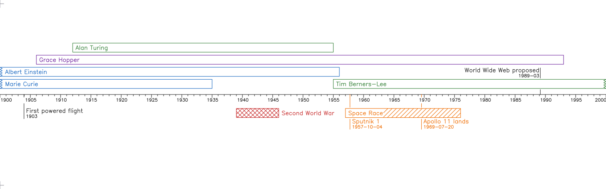

# AxiTimeline

Timelines drawn by a pen plotter on long rolls of paper. You describe people, events and periods in a plain-text
language, `.axitl`, and AxiTimeline lays them out, draws every line and letter as pen strokes, and plots them on
an [AxiDraw SE/A3](https://axidraw.com/) one pen at a time, moving the roll through in strips.

This repository is the software:

- **libaxitl**, the engine: it parses `.axitl`, lays the timeline out and renders it as SVG. It's a pure library
  with no file, network or clock access of its own, so other programs (a web front-end, say) can reuse it.
- **axitime**, the command-line program that hosts libaxitl, writes the SVG files and drives the plotter.
- An editor extension for **VS Code**, with highlighting, completion, hover help and errors as you type.

**Status, October 2026.** Parsing, layout, rendering and the `check`, `list-pens` and `render` commands work.
`plot` works against a simulated plotter but hasn't yet been run on a real AxiDraw. The paper transport (the
motorised roll feed) is still to be designed, so for now `plot` asks you to move the paper on by hand between
strips.

## What it looks like

This source, [`examples/century.axitl`](examples/century.axitl):

```text
timeline start=1900 end=1999 length=40cm width=120 baseline=middle

^!!person "Marie Curie" 1867-1934 blue
^!person "Albert Einstein" 1879-1955 blue
^person "Grace Hopper" 1906-1992 violet
^person "Alan Turing" 1912-1954 green
^person "Tim Berners-Lee" 1955- green

v!span "Second World War" 1939-1945 red fill=crosshatch

!group "Space Race" 1957-1975 orange fill=diagonal time_label=day {
  event "Sputnik 1" 1957-10-04
  event "Apollo 11 lands" 1969-07-20
}

event "First powered flight" 1903-12-17 time_label=year
event "World Wide Web proposed" 1989-03 time_label=month
```

is drawn like this (the preview `axitime render` writes, with each pen in its own colour):



Some things to notice:
- Lives that began before 1900 get a torn edge where the timeline starts, as does one still going at its end.
- `^` and `v` put an entry above or below the baseline. Without one, AxiTimeline chooses the side with room.
- `!` and `-` raise or lower an entry's priority, which decides who gets the lanes nearest the baseline.
- Events stand on poles. A pole is broken wherever it would cross other ink, and `time_label=` writes the date
  under the event's name.
- Every letter is drawn as strokes from a single-line Hershey font, which a pen can draw.

## Getting started

You need [uv](https://docs.astral.sh/uv/), which also fetches Python 3.12 if you don't have it. From the repo:

```bash
uv sync
```

```bash
uv run axitime check examples/century.axitl
```

```bash
uv run axitime render examples/century.axitl -o renders
```

`render` writes `renders/century-preview.svg` with every pen, and one `century-<pen>.svg` per pen for plotting.
They're at true size in millimetres, so they open in Inkscape with each pen as a layer:

```bash
open -a Inkscape renders/century-preview.svg
```

On the computer that drives the AxiDraw, install its Python API as well (it comes from Evil Mad Scientist, not
PyPI):

```bash
uv sync --extra axidraw
```

## Commands

| Command | What it does |
|---|---|
| `axitime check FILE` | Parses and lays out the timeline and reports errors and warnings: bad dates, a full lane, a label that can't fit, a page wider than the plotter reaches. `--json` for scripts. |
| `axitime list-pens FILE` | The pens the job needs, the baseline's pen first, with how much each one draws. |
| `axitime render FILE -o DIR` | Writes the preview and one SVG per pen. A slice of the roll with `--start-offset`/`--length` (e.g. `137cm`) or `--from`/`--to` (dates); `--bleed` (default 2mm) runs ink past a cut edge. |
| `axitime plot FILE-PEN.svg` | Plots one pen's SVG. `--simulate` shows the strips without moving anything; `--dry-run` goes through every motion with the pen up; `--start-offset` resumes partway along the roll. |

A timeline that ends at `now` takes the clock's date; `--now DATE` pins it, so a job can be re-rendered later
exactly as it was.

## Plotting a job

A job is plotted one pen at a time, from the per-pen SVGs `render` wrote. The first pass is the pen that draws the
baseline and its ruler-like ticks (`black`). Those are the reference every later pass, and any resumed run, lines
up against.

- **Before moving**, `plot` shows the pen, the stretch of roll, the ink and the strips, then asks you to type the
  pen's name. Answering y/n would be too easy to wave through on autopilot.
- **The roll goes through in strips** the AxiDraw can reach (40cm by default). Between strips you move the paper
  on by an exact distance, until the motorised transport exists. Strips with nothing for the current pen are
  skipped.
- **Ctrl+C, the AxiDraw's pause button, or any error** lifts the pen, sends the carriage home and switches the
  motors off. The job log then says where it stopped, so you know what `--start-offset` to resume from.
  Measure from a labelled tick, or from the pencil crop marks every 50cm.
- **A job log** beside the SVGs records every run. Each SVG carries a job hash, a fingerprint of the source, the
  software versions, `now` and every illustration and font used. `plot` refuses a file from a different version
  of a timeline it has already started plotting, so passes drawn from different layouts can't end up on the same
  paper (`--force` overrides this, and the log records it).

The plotter's travel, strip length and pen settings can be adjusted in `~/.config/axitime/plotter.toml`; see
[`axitime/config.py`](axitime/src/axitime/config.py).

## The language in brief

```text
[side][priority]keyword "Label" dates [pen] [key=value ...] [illustration(file.svg)]
```

- **Entries:** `person`, `span` and `group` are bars in lanes. An `event` is a single moment on a pole. A group's
  members, in `{ }`, take its side, pen and settings unless they say otherwise.
- **Dates:**
  - Write a date at any precision, from `1963` to `1963-11-22T12:30:00`.
  - Years before AD 1 take `BC`: `44BC-03-15`.
  - Ranges are `1642-1727` between years, and `1962-10-16/1962-10-28` when either end is finer than a year.
  - `1953-` is ongoing.
- **Pens** are named after what goes in the plotter: `red`, `blue` and so on, `HB-pencil` and other grades, and
  `fountain-blue`.
- **Settings:**
  - `fill=` shades bars: `diagonal`, `crosshatch`, `wave`, `dots` or `solid`.
  - `font=` takes a built-in Hershey font, or your own SVG stroke font, and `font_size=` sets the size.
  - `time_label=` writes an event's date under its name.
- **Files:**
  - `include "file.axitl"` pulls in shared entries, optionally shifting their priority or side.
  - `illustration(file.svg)` attaches a drawing to an entry.
  - `//` starts a comment.
- **Lengths** are millimetres unless they say `cm` or `m`.

The full rules are in [`docs/language-spec.md`](docs/language-spec.md). The other examples show more:
[`industrial.axitl`](examples/industrial.axitl) uses includes, groups and an illustration,
[`chernobyl.axitl`](examples/chernobyl.axitl) is a timeline to the second, and [`labels.axitl`](examples/labels.axitl)
shows where labels go when they're longer than their bars.

## Editor support

[`editors/vscode`](editors/vscode) adds `.axitl` support to VS Code:
- highlighting, in which typos stay uncoloured;
- completion that knows what fits where;
- hover help taken from the language spec;
- the errors and warnings from `axitime check`, shown when you open or save a file.

Its [README](editors/vscode/README.md) explains how to install it.

## How it fits together

```text
.axitl ──parse──> AST ──layout──> ResolvedLayout ──draw──> strokes ──render──> SVG, one per pen ──plot──> paper
  │                       ▲
  └── includes, fonts,    └── now (the clock, or --now)
      illustrations
```

- `parse` is the only stage that reads anything beyond the text it's given, through a function its host supplies.
  That function gives libaxitl its includes, illustrations and custom fonts.
- `layout` and `render` are pure: the same input always gives byte-identical output.
- `plot` never reads `.axitl`, only a frozen per-pen SVG. So every pass of a job draws from exactly the same
  layout.

The design is written up in [`docs/interpreter-cli-spec.md`](docs/interpreter-cli-spec.md), and
[`docs/known-gaps.md`](docs/known-gaps.md) lists what's still undecided.

## Repository layout

| Path | Contents |
|---|---|
| `libaxitl/` | The engine: parsing, dates, layout, text shaping, drawing and SVG rendering, with the bundled fonts |
| `axitime/` | The command line, the job hash and log, and the plotter and paper-transport drivers |
| `editors/vscode/` | The VS Code extension |
| `examples/` | Example timelines |
| `docs/` | The language and interpreter specs (the canonical copies) and the list of known gaps |
| `vendor/` | One wheel from the AxiDraw API, kept here so installs work on any machine ([why](vendor/README.md)) |

## Development

```bash
uv run pytest
```

The tests cover parsing, layout, rendering, the job hash, plotting against a simulated AxiDraw, and the editor
extension's vocabulary. The extension's own tests run under node:

```bash
node editors/vscode/test/run.js
```

The specs in `docs/` are the intent. When the code and a spec disagree, one of them gets fixed on purpose, in the
same commit, rather than left to drift.

## Licence

AxiTimeline is MIT licensed (see [`LICENSE`](LICENSE)), with these exceptions:
- **The Hershey fonts** in `libaxitl/src/libaxitl/fonts/data/` carry their original notice.
- **The EMS fonts** in the same folder are under the SIL Open Font License; see the notices beside them.
- **The vendored `axidrawinternal` wheel** is from Evil Mad Scientist's AxiDraw software, under the GNU GPL v2
  ([`vendor/`](vendor/)).
