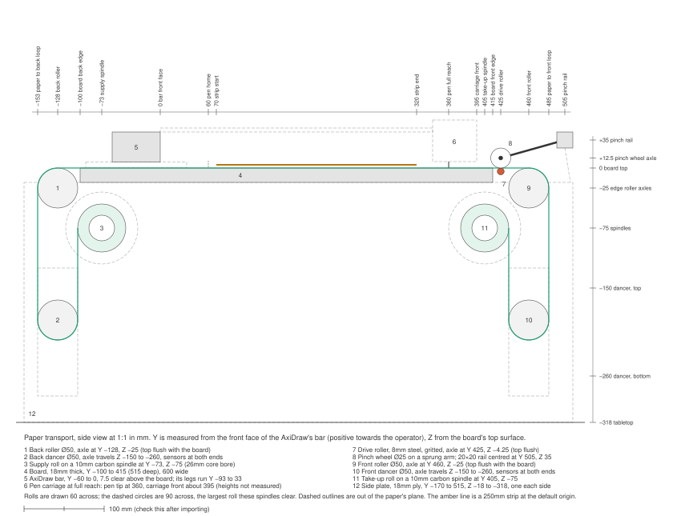

> **Draft, 2026-10-15; revised 2026-10-22.** The paper transport's hardware, worked out with the author before
> anything is built. Nothing here is settled until it has been built and tested; change it as the hardware
> changes. The 2026-10-22 revision replaced the plywood stand with printed brackets on 2020 legs and fitted
> the layout to the board the AxiDraw is already mounted on. The software side is in
> `docs/interpreter-cli-spec.md` ("The roll's orientation") and item 3 of `docs/known-gaps.md`.

# Paper transport

The transport moves the roll under the AxiDraw SE/A3, along its Y axis and under its bar, so that `plot` can
draw a long timeline in strips. The printed parts are modelled in OpenSCAD in `hardware/transport/`, whose
README lists what to print, the hardware, and the order of assembly.

## What it has to do

- **Move the paper both ways.** Every pen is its own pass along the whole roll, so after each pass the roll
  winds back to the start. Both rolls need motors, and the paper on the board must be held the same way in
  either direction.
- **Advance exactly `strip_mm`.** Strokes cut at a strip edge only meet again if the paper moves exactly a
  strip's length, and pens only line up if every pass puts the paper in the same place. Aim for 0.1mm per
  advance. The AxiDraw itself repeats very well (first hardware runs, 2026-10-14), so this is where the
  accuracy has to come from.
- **Keep the paper flat at one height under the pen.** Only paper fits under the AxiDraw's bar: it is 7.5mm
  above the board.
- **Handle art paper over 150gsm.** Never bend the paper tighter than a roll core, about 25mm radius. The roll
  on hand (430mm wide, 26mm core bore) is already bent tighter than that at its core, so 50mm rollers suit
  it too.

## Paper path

The board is raised on four legs, with the supply roll below its back edge and the take-up roll below its front
edge. Between each roll and the board the paper hangs in a loop, with a weighted roller (a **dancer**) resting
in it:

1. The supply roll pays out into the back loop, around the back dancer, and up over the back roller.
2. The paper crosses the board, under the bar, past the pen.
3. It passes flat over the **drive roller**, set flush with the board just beyond the pen's reach, with a
   sprung **pinch wheel** pressing it down onto each margin, as on a vinyl cutter.
4. It turns down over the front roller, around the front dancer, and up onto the take-up roll.

- **The dancers set the tension.** Each holds its loop at half its own weight, whichever way the paper moves
  and however full the rolls are. About 400g gives 2N.
- **The rolls only keep their dancers in range.** Each roll motor runs to keep its dancer between two sensors,
  so it needs no precision.
- **The drive roller does the measuring.** It is the only part whose movement has to be exact.
- **Little rises above the board, and only beyond the pen carriage's reach:** the pinch wheels and their rail,
  the drive roller's bearing housings (21 above the board) and its motor (17 above).
- **It feeds towards the front.** That matches the default `feed = "towards-front"`: supply at the back,
  finished roll at the front where the operator can see it.

## Layout

Coordinates: **Y** is measured from the front face of the AxiDraw's bar, positive towards the operator. **Z** is
measured from the board's top surface, positive up. **X** is measured from the paper's centreline; +X is the
operator's left. All in mm. The drawing above is at 1:1, so it can be inserted into a Fusion sketch (Insert >
Insert SVG); check its 100mm scale bar after importing, and delete the white background rectangle if it comes
in too. `hardware/transport/params.scad` holds the same numbers.

### The AxiDraw and its board (measured 2026-10-14 to 22)

| Part | Where |
|---|---|
| Board | Y −85 to 365 (450 deep), 640 wide, 6.5 thick. The AxiDraw is already fixed to it. |
| Bar | Y −60 to 0 (its rear face 25 in from the board's back edge), 7.5 clear above the board |
| Legs | Y −93 to 33 (overhanging the board's back edge by about 8); 15 wide, 500 apart inside |
| Pen tip | Y 60 at home, 300 of travel, Y 360 at full reach |
| Pen carriage | Ends about 30 in front of the pen tip (to the thumbscrew), so about Y 395 at full reach |
| A 250mm strip | Y 70 to 320 at the default `origin_along_mm` of 10 |

### Along the paper (Y) and up (Z)

| Part | Y | Z |
|---|---|---|
| Back roller, Ø50 | −128 | −25 (top flush with the board) |
| Back dancer, Ø50 | −128 | travels −150 to −260 |
| Supply roll's axis, between its cones | −73 | −75 |
| Take-up roll's axis | 405 | −75 |
| Drive roller, 8mm | 425 | −4.25 (top flush) |
| Pinch wheel axle, Ø25 wheel | 425 | 12.5 |
| Front roller, Ø50 | 460 | −25 (top flush) |
| Front dancer, Ø50 | 460 | travels −150 to −260 |
| Pinch rail, 20×20 | 505 | 35 (25 to 45) |
| Legs, 2020 × 300 | −153 and 485 (centres) | −12 to −312 |
| Back brackets | −168 to 3 | |
| Front brackets | 335 to 515 | |
| Tabletop | | −317 |

- **Clearances:**
  - The pinch wheel's rearmost point is at Y 412.5, about 17 clear of the carriage at full reach.
  - The back roller is about 22 clear of the board's back corner.
  - A full 90mm roll clears the board's underside by 23, an edge roller by 4, and a dancer at the top of its
    travel by 5. A roll larger than 90mm needs the roll axes lower.
  - Between the board's front edge (365) and the drive roller (425) the paper spans 56mm unsupported, held
    straight by its tension.
- **Stand height:** 300mm legs under the brackets' 12mm caps put the board's top 317mm above the table.

### Across the paper (X)

| Part | Where |
|---|---|
| Paper roll on hand | 430 wide, X ±215 |
| Inked page | Up to 400 wide, X ±200, leaving each pinch wheel the outer 15mm of the paper |
| Back and front rollers | 460 long, X ±230 |
| Dancers | 470 long, X ±235 |
| Brackets | Inner faces at X ±245, outer at ±275, against the legs (X ±275 to ±295) |
| Board | 640 wide, X ±320. The clamp bolts run in slots at X ±325 to ±345, outside its edges |

Centre the paper on the pen's X travel, not on the AxiDraw's legs or the board: slide the whole transport along
the board's edges until the rollers' centre is under the middle of the pen's travel (the clamps' slots allow
the board to sit about 15 off-centre). A 400mm page then runs from 15 to 415 across, so `origin_across_mm`
becomes about 15, and the finished `width=` can be up to about 395 (crop marks reach 2.5 beyond each finished
edge).

## Parts

### Stand

- **Legs and feet:** four 300mm 2020 extrusions stand on printed feet. Each carries a printed **corner
  bracket** at its top: a 30mm plate against the leg's inner face, with a cap over the leg's end and cheeks
  either side, screwed into T-nuts.
- **The brackets carry everything:** every bearing, cone and motor bolts through them at its place in the layout.
- **Board clamps:** each bracket has a seat under the board's corner. A printed jaw on top bolts to the seat
  outside the board's edge, so the board isn't drilled.
- **Dancer guides:** these bolt to the legs lower down, with a slot open at the top for each dancer's axle.
- **Squaring:** the AxiDraw is already fixed to the board, so squareness is set at the transport: the drive
  roller's housings first, then the back roller's trim (see "Accuracy and setting up").
- **Board surface:** flat and smooth. A thin smooth sheet laid under the paper's path, but not under the feet,
  would also bring the paper closer to the pen while leaving at least 4.5mm under the bar.

### Drive roller and pinch wheels

- **Roller:** the 8mm solid steel rod, 501 long, on 608ZZ bearings.
  - The bearings sit in printed housings bolted to the front brackets through oversize holes, so the roller
    can be set flush with the board and square to the AxiDraw's Y axis. Printed collars locate it endwise.
  - Clean the patina off where the bearings sit, and roll the rod on something flat to check it's straight.
- **Drive:** the motor drives the rod directly, through a 5-to-8mm flexible beam coupler in a pocket in the
  right front bracket, with no belt.
  - An 8.5mm roller and 200 steps per turn give 0.13mm per full step, or 0.008mm at 1/16 microstepping. That's
    well inside the 0.1mm target, and the coupler adds no play.
- **Grit:** bands of epoxy and 120–180 grit aluminium oxide under the wheel tracks (X ±200 to ±215 for the 430
  roll).
  - Apply it while the motor turns the rod slowly, so the coat comes out even. A roller even a hair thicker
    under one wheel feeds that side faster and steers the paper sideways.
  - Finish with a thin sealing coat so no grains shed onto the board, where one under the paper would make the
    pen skip.
- **Pinch wheels:** the 25mm hard-plastic wheels, on M5 bolts.
  - Each wheel sits beside a flat printed arm that pivots on a printed block. The block hangs under the 20×20
    rail on one T-nut, so it can sit over the margins of any roll width.
  - An extension spring from the block to the arm's tail presses the wheel down. Pressing the tail lifts it
    for threading.

### Edge rollers and dancers

- **Construction:** each roller is two 50mm printed halves, printed upright and glued onto a carbon tube spine:
  - 420 of the 18mm tube for the back and front rollers;
  - 440 of the 14mm tube for the dancers.
- **Bearings:** each half's outer end holds a 608ZZ. Neither tube's bore takes the 604s or 608s directly, which
  is why the bearings sit in the printed ends.
- **Back and front rollers:** they run on M8 bolts screwed in from outside through nuts captured in the
  brackets, with 15mm spacers. One end of the back roller's bolt is in a slot, front to back, as a tracking trim.
- **Dancers:**
  - Each carries captive M8 × 70 bolts, heads inside, which drop into the guides' open slots.
  - Two Omron EE-SX672 slot sensors screw flat to one guide per dancer (back left, front right), at the top
    and bottom of its travel. A printed flag on the dancer's bolt runs through their slots, and the axle's
    slot runs 5mm past the bottom sensor so it trips before the bolt reaches its end.
  - The dancer halves' infill sets the weight: at 20% a dancer with its bolts is about 450g. Washers on the
    bolts add more if the paper's curl needs more tension.

### Rolls

- **Cones, no spindle:** each roll is held between two printed cones that enter its core's ends.
- **The left cone is driven.** It carries a 48-tooth gear and runs on a 608 on a fixed M8 bolt. The roll motor
  turns it 3:1 through a 16-tooth gear; the motor sits in a pocket in the left bracket, below the take-up cone
  and in front of the supply cone.
- **The right cone is a tailstock.** Its 608 is clamped on an M8 × 100 bolt that screws through a nut captured
  in the bracket, with a knob on its head. Wind it out to release the roll, and in to grip it.
  - The cones handle cores of about 425 to 440, within the tailstock's travel.
- **Take-up core:** the take-up roll needs an empty core with a 26mm bore and the paper's full width, to tape
  the paper's leading end to. The spent supply roll's core will do.

## Electronics

- **Controller:** a Raspberry Pi Pico, on USB to the Pi, which also powers it. The serial protocol for
  `advance(mm, next_start)` is still to be written.
- **Drivers:** three Pololu TB67S581FNG carriers, wired for step and direction (plus a shared enable) and
  driven straight from the Pico's 3.3V pins.
  - Hard-wire the microstep mode pins to 1/16 or 1/32.
  - Set the current with the trimpot before soldering the headers. Start at about 0.8A for the drive roller
    and 0.6A for the rolls; the motors (Rtelligent 42A02C, 1.5A, about 0.42 N·m) need little torque here.
  - Fit a 100µF electrolytic across each board's motor supply; Pololu warns that voltage spikes can destroy
    these boards at 24V.
  - Never unplug a motor while it's powered.
- **They don't cut the current when holding still,** unlike a TMC2209, and they're audible. All three motors
  must stay powered through a plot, because if the roll motors switch off, the dancers' weight unwinds both
  rolls. So keep the currents low.
- **Power:** the 24V 10A supply for the drivers, with its ground joined to the Pico's. The drivers make their
  own logic supply. The dancer sensors need 5V; take it from the Pico's VBUS pin (USB 5V) or from the 24V-to-5V
  converter. The four draw about 140mA at most.
- **Sensors:**
  - Four Omron EE-SX672-WR slot sensors for the dancers, wired so a broken wire reads as "at the limit":
    - Brown to 5V and blue to ground.
    - Black (an NPN open-collector output) to a Pico GPIO, with a 4.7–10kΩ pull-up to the Pico's 3.3V, never
      to 5V: the Pico's inputs aren't 5V tolerant.
    - Pink (L) to brown, for light-ON. The output then pulls the pin low while the beam is clear. When the
      flag blocks the beam, or a wire breaks, the pull-up reads high, so the firmware treats high as "stop".
  - Optionally, a paper-out sensor.
  - The optical flow sensor, over SPI, to catch slipping rather than to measure moves (mouse-type sensors
    drift by around a percent).
  - Optionally, a "transport fault, pause the plot" line to the EBB's B0 input. Keep it away from the motor
    wiring, which could set off phantom pauses.
- **Pins:** about 20 of the Pico's 26 GPIO: 6 for step and direction, 1 enable, 4 dancer sensors, 1 paper-out,
  1 pause line, and about 5 for SPI.

## Accuracy and setting up

- **Squareness comes first.** A drive roller 0.1° off square steers the paper about 26mm sideways over 15m, and
  it does that forwards and back for every pen.
  - Square the drive roller to the AxiDraw's Y axis with its housings' oversize holes.
  - Trim what's left with the back roller.
  - The test: draw a long line in a margin, advance a strip, and draw it again.
- **Calibrate the drive roller's scale once.** Its exact diameter (with grit) is the one error that grows with
  distance. Measure it against the 50cm crop marks over a few metres and set it as a factor.
- **Finish every advance moving forwards.** Ending each move in the same direction takes up any play in the
  drive.
- **Repeatable errors don't misregister pens.** Every pass makes the same moves, so they land where earlier
  passes did. Only the joins between strips see a single advance's error.
- **If more accuracy is needed later,** a small reflective sensor at the front edge could stop the paper on a
  mark drawn in the trim margin. Leave room for a bracket there.

## Still open

- **The full roll's outside diameter.** The roll axes at Z −75 clear a roll up to 90mm across.
- **Where the AxiDraw's home sits across, relative to its legs.** With the paper centred on the travel it must
  still clear both legs: 35mm each side if the travel is centred between them.
- **The pinch wheels' tread width** (`wheel_w`, 8 in the model).
- **Whether the printed stand is stiff enough.** If the board sways while the AxiDraw moves, add a cross-brace
  between each pair of legs near the table, or clamp the feet down.
- **The controller's serial protocol** and the `transport` setting in `plotter.toml` that will select it.
- **Which paper.** The roll on hand is of unknown weight and length; art paper over 150gsm is the aim.
