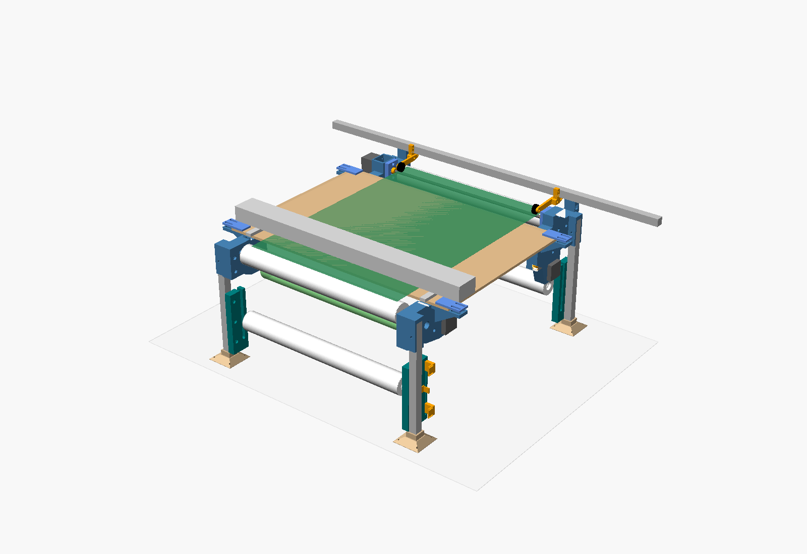

# Paper transport: printed parts

OpenSCAD models of every printed part of the paper transport. The design (paper path, layout, why it's
shaped this way) is in [docs/transport.md](../../docs/transport.md). This file covers building the parts
and putting them together.

- `params.scad`: every dimension, in the doc's coordinates (x across from the paper's centreline, +x the
  operator's left; y from the AxiDraw bar's front face, +y towards the operator; z up from the board's top).
- `lib.scad`: helpers, including an involute gear.
- `transport.scad`: the parts, an assembly view, and a print layout for each part. Open it in OpenSCAD and
  pick `part` in the Customizer; `assembly` shows everything in place (`show_paper` and `show_board` hide
  the paper, rolls, board and AxiDraw so the brackets can be seen).
- `build.sh`: exports every part to `stl/` (not committed), laid flat for printing, and runs `check_fit.py`,
  which confirms each one fits the Prusa Core One's 250 × 220 × 270 bed and sits on it. A full build takes
  about ten minutes; `./build.sh foot board_jaw` builds just those.

Tested with OpenSCAD 2021.01 on macOS (Intel).

## What to print

| Part | Qty | Notes |
|---|---|---|
| `back_bracket_left` | 1 | Supply roll's drive cone and motor. Lay on its large flat face (as exported). |
| `back_bracket_right` | 1 | Supply tailstock. The back roller's bolt slot here is the tracking trim. |
| `front_bracket_left` | 1 | Take-up roll's drive cone and motor. |
| `front_bracket_right` | 1 | Take-up tailstock, and the pocket for the drive roller's coupler. |
| `drive_motor_mount` | 1 | Holds the drive motor 10mm off the front-right bracket. Print it motor face down. |
| `drive_housing` | 2 | The drive roller's 608s. Oversize bolt holes let you set its height and squareness. |
| `dancer_guide_full` | 2 | Back left and front right: the flag slider's recess, and screw holes for two sensors. |
| `dancer_guide_plain` | 2 | Back right and front left. |
| `flag_slider` | 2 | Rides in the full guide's recess on the dancer's bolt. Print it in black: the sensors' infrared passes through light-coloured plastic. |
| `roller_half` | 4 | Two per edge roller (back and front). Print upright. |
| `dancer_half` | 4 | Two per dancer. Print upright; the infill sets the dancer's weight (below). |
| `drive_cone` | 2 | 48-tooth gear and cone. Gear face down. |
| `tail_cone` | 2 | |
| `tail_knob` | 2 | Takes the head of an M8 × 100 bolt. |
| `motor_gear` | 2 | 16 teeth, on the roll motors' D shafts. |
| `spacers` | 1 set | 4 × 15mm (edge rollers), 2 × 9mm (drive cones), 4 × 22mm (dancers). |
| `rod_collar` | 2 | Locate the drive roller endwise, one just inboard of each drive housing. |
| `pinch_block` | 2 | Flat plates; the second of each is the same part turned over. |
| `pinch_arm` | 2 | |
| `board_jaw` | 4 | Clamp the board's corners to the brackets' seats without drilling it. |
| `foot` | 4 | One under each leg; screw holes if you want to fix them to the table. |

**Material and settings.**
- **All parts:** 0.2mm layers, 4 perimeters, 25–30% gyroid infill unless noted below.
- **PLA is fine for most of the plastic:** the roller and dancer halves (about half of it on their own),
  both kinds of dancer guide, `back_bracket_right`, and the feet, board jaws, tail cones, tail knobs, flag
  sliders (black) and spacers. Add a drop of retaining compound or CA glue to each bearing pressed
  into PLA, because PLA lets a press fit relax over time. Keep the transport away from radiators and sunny
  windows, since PLA softens at about 55°C.
- **PETG or PETG-CF for the rest:**
  - The three brackets that carry motors (`back_bracket_left`, `front_bracket_left`, `front_bracket_right`),
    and `drive_motor_mount`.
    The drivers hold current all the time, so the motors stay warm, and PLA creeps when it's warm and under
    load. The front two also hold the drive roller's alignment; PETG-CF is the stiffest choice for them.
  - `drive_housing` (it sets the drive roller's alignment), `motor_gear` and `drive_cone` (or nylon for
    both), `pinch_arm` and `pinch_block` (always under the spring's load), and `rod_collar`. Together these
    are only a few percent of the plastic.
  - If you want to save more, `back_bracket_left` is the one to risk in PLA, as long as its motor stays cool
    enough to keep a hand on.
- **No supports anywhere,** printed as exported.
  - Recesses that print against the bed (the brackets' and guides' counterbores and nut pockets) are
    roofed by two bridging layers, sized for 0.2mm layers. If you print those parts at another layer height,
    change `layer` in `params.scad`.
  - Steps inside the cones and roller halves narrow at 45°.
- **Gears:** PETG or nylon, at 40% infill or more.
- **Edge roller halves:** 10–15% infill, to keep them light.
- **Dancer halves:** the infill is the dancer's weight. At 20% a dancer with its bolts comes to about 450g,
  which is about 2.2N of tension on the paper. Use more infill, or washers on its bolts, for more.

## Hardware

Stock you have, cut to length (a hacksaw and a mitre box will do; wear a mask cutting carbon):

| Item | Cut | Use |
|---|---|---|
| 8mm steel rod | 1 × 501mm | Drive roller: from its left bearing to 11mm into the coupler |
| 18mm carbon tube | 2 × 420mm | Spines of the back and front rollers |
| 14mm carbon tube | 2 × 440mm | Spines of the dancers |
| 2020 extrusion, 300mm | 4 | Legs, uncut |
| 2020 extrusion, 1m | 1 × 560mm or more | Pinch rail (or leave it at 1m; it just overhangs) |

To buy or find:
- **Bearings:** 14 × 608ZZ: two in each edge roller, two in each dancer, two for the drive roller, one in
  each cone.
- **Coupler:** 1 × flexible beam coupler, 5mm to 8mm, about 19 × 25mm.
- **Motors:** 3 × NEMA 17 (yours are 37mm long).
  - The two roll motors bolt to their brackets' inner skins with M3 × 8 screws, from inside.
  - The drive motor bolts to `drive_motor_mount` with M3 × 8 screws from the mount's bracket side (their
    heads sit in counterbores). The mount then screws to the bracket with 4 × M3 × 25 beside the motor; these
    cut their own thread in the bracket's pilot holes, so don't overtighten them.
- **Dancer sensors:** 4 × Omron EE-SX672-WR slot sensors (NPN, 5mm slot), two on each full guide, each
  held by 2 × M3 × 25 into nuts captured in the guide's inner face.
- **Springs:** 2 × small extension springs, about 6mm across and 20mm long, for the pinch arms.
- **Grit:** epoxy and 120–180 grit aluminium oxide.
- **M8:**
  - 4 × M8 × 60 for the edge rollers' axles.
  - 2 × M8 × 60 for the drive cones' axles, each with a nut.
  - 4 × M8 × 70 for the dancers' axles, each with a nut and washers. Their heads are captive inside the
    dancers, so they need a hex, button or pan head (see "Bolt heads").
  - 2 × M8 × 100 hex-head bolts for the tailstocks (the head sits in the knob's hex pocket), each with 4 nuts:
    one captured in the bracket, two clamping the bearing, one jam nut. A length of M8 threaded rod with a nut
    in the knob does the same job.
  - 4 more M8 nuts, captured in the brackets for the edge rollers' axles.
- **M5:**
  - 32 T-nuts for 2020.
  - Bracket to leg: 8 × M5 × 30 through the plate, and 8 × M5 × 10 through the cheeks.
  - Guide to leg: 12 × M5 × 16.
  - Drive housings: 2 × M5 × 45 on the left, 2 × M5 × 20 with nuts on the right, all four with large
    (penny) washers, because the housings' holes are oversize for adjustment.
  - Board jaws: 8 × M5 × 25 with nuts.
  - Rail on its posts: 2 × M5 × 16, put in from the window in each post and turned from beneath.
  - Pinch wheels: blocks on the rail 2 × M5 × 12, through each block's lip into the rail's rear slot; pivots
    2 × M5 × 25 with nuts; wheel axles 2 × M5 × 25 with nuts and washers.
- **M3:**
  - 12 × M3 × 8 for the motors.
  - 4 × M3 × 25 to fix the drive motor's mount to its bracket.
  - 4 × M3 × 6 grub screws with nuts, for the motor gears and rod collars.
  - 4 × M3 × 20 with nuts, as the spring pins.
  - 8 × M3 × 25 with nuts for the dancer sensors.
- **M4:** 16 × M4 wood screws, if you fix the feet down.

### Bolt heads

Hex socket pan or button heads work everywhere, and nothing needs a countersunk head. Three places limit
the choice:

| Where | Head |
|---|---|
| Dancers' M8 × 70, captive inside the dancer | Hex, button or pan. The cavity is 18 across and 7 deep, so a socket cap head (8 tall) won't fit. |
| Tailstocks' M8 × 100 | Hex head, to key into the knob. |
| Rail on its posts, M5 × 16 | Any hex socket head, since it's turned from beneath inside the window. |

Everything else has room for any head:
- **Counterbores.** The bracket-to-leg and guide-to-leg M5s sit in counterbores 10 across, which take socket
  cap, pan or button heads.
- **Washers.** The drive housings' M5s need large washers under any head.
- **Board jaws.** The jaw bolts sit 7 and 17mm in from the board's edge, so at the back they stay clear of the
  AxiDraw's bar. A button head keeps them lowest on top of the board.

## Putting it together

1. **Rollers.** Press a 608 into the end of each roller half. Glue two halves onto each spine with epoxy, so
   the halves meet in the middle and the bearings face out. Check the roller runs true before the glue sets.
2. **Dancers.** Before pressing each dancer half's bearing in, push an M8 × 70 through it from the inside, so
   the bolt's head is captive in the half. Then glue the halves onto the 14mm spines as above.
3. **Legs.**
   - Push each leg up into its bracket's cap, between the cheeks.
   - Screw it on through the plate and cheeks into T-nuts. Pre-load the T-nuts in the leg's slots first.
   - Fit a foot on the bottom. Bolt the dancer guides to the legs' inner faces.
4. **Board.**
   - Stand the four corners up and lay the board (with the AxiDraw) on the seats.
   - Fit the jaws on top, bolting through the seats outside the board's edges.
   - Slide the whole transport sideways until the paper's centreline is under the middle of the pen's travel,
     then tighten.
5. **Drive roller.**
   - Grit the rod where the pinch wheels run: 200 to 215mm either side of the paper's centreline.
   - Press the 608s into the housings and slide them onto the rod with a collar inside each.
   - Bolt the housings to the front brackets, loosely. On the right, their nuts go inside the coupler's pocket,
     reached from its open top.
   - Set the rod's top flush with the board and square to the AxiDraw's Y axis, then tighten the housings.
   - On the bench, bolt the drive motor to `drive_motor_mount`, then fit the coupler on the motor's shaft and
     tighten its motor-side set screw.
   - Slide the motor, mount and coupler onto the end of the rod, so the coupler sits in the bracket's pocket.
     Screw the mount to the bracket, then turn the rod until the coupler's other set screw faces up, and
     tighten it through the pocket's open top.
6. **Back and front rollers.** Hold each between its brackets and screw the M8 × 60 axles in from outside,
   through the brackets' captured nuts. Put a 15mm spacer between each bracket and roller.
7. **Roll holders.** On the left, bolt each drive cone on with a 9mm spacer, and fit its motor and gear. On
   the right, run the M8 × 100 (head in the knob) through the bracket's captured nut, then a nut, the tail
   cone's bearing, and a nut.
8. **Pinch rail and arms.**
   - Bolt the rail onto the two posts on the front brackets.
   - Fit a block under the rail above each wheel track, screwed through its lip into a T-nut in the rail's
     rear slot, and hang each arm on its block.
   - Put each wheel on its arm and hook the springs on their pins.
9. **Dancers.** Fit the 22mm spacers on the dancers' bolts and drop the bolts into the guides' open slots.
   Add the flag sliders on the full guides, then washers and nuts.
10. **Sensors.**
    - Press an M3 nut into each of the four hex pockets on the full guides' inner faces.
    - Screw each EE-SX672 on by its tab, flat against the guide's outer face, with its slot facing the flag.
    - Two go on each full guide, one above the other. The flag's fin then runs through the top sensor's slot
      as the dancer reaches the top of its travel (Z −150), and through the bottom one at the bottom (Z −260).
      The axle's slot runs 5mm further down, so the bottom sensor trips before the bolt reaches its end.

The left and right sides here are as the operator sees them, standing at the front.
